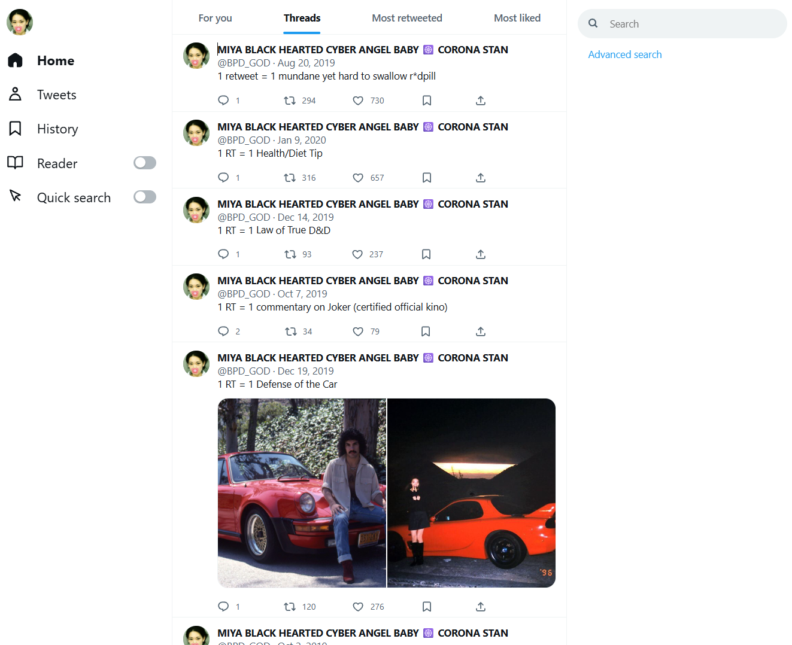

# Miya Archive

The tweet archive of **Miya Black Hearted Cyber Angel Baby** (@BPD_GOD): every tweet, thread, reply, and photo in one place, searchable and browsable.

## Use it

The standalone build is a single zip download requiring no installation or configuration. Download the latest version from the [Releases page](https://github.com/homerclassic/miya-archive/releases), unzip it, and open `miya-archive-standalone.html`. Alternatively, browse the archive online at https://homerclassic.github.io/miya-archive/.

## Features

* Filter and sort searches by year, photos and video, likes, retweets, and tweet type
* Like and bookmark tweets to find them again later
* Download a thread as a PDF

## Run from source

Prerequisites: Node.js or Python. No account, API key, or backend is required — the archive (tweets and photos) is included.

The project root must be served over HTTP. Opening `index.html` via `file://` is unsupported: browsers block ES module imports and `fetch()` requests from local files.

| Runtime | Command (from the project root) | URL |
| --- | --- | --- |
| Node.js | `npm run dev` | http://localhost:8080 |
| Python, macOS/Linux | `python3 -m http.server` | http://localhost:8000 |
| Python, Windows | `python -m http.server` | http://localhost:8000 |

The server process must remain running while the site is in use.

Optional production build: `npm install`, then `npm run build` (output in `dist/`) and `npm run preview`.

## Privacy

The site has no analytics. Likes, bookmarks, recent searches, and cached embeds are stored only in your own browser. To show content that isn't in the archive, your browser contacts X's public embed endpoint (with FxTwitter and VxTwitter as fallbacks) for embedded posts, unavatar.io for other accounts' avatars, and i.ytimg.com for YouTube thumbnails. Those services can see your IP address and which post or account was requested.

## License

[Viral Public License](LICENSE). Any work that copies or derives from this code must keep the license in full and may not add further restrictions.
